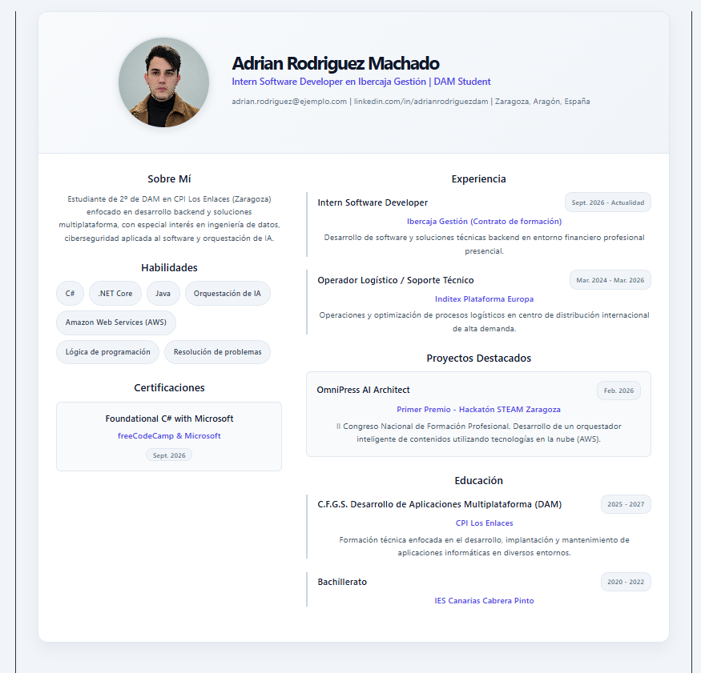

# 📄 CV Personal Interactivo — React & Vite


Este proyecto consiste en el desarrollo de un Currículum Vitae profesional e interactivo implementado como Single Page Application (SPA) con **React**, empaquetado y servido a través de **Vite**, y estilizado mediante **CSS3 puro**.

---

## 📸 Vista Previa del Proyecto

<p align="center">
  
</p>

---

## 📌 Descripción del Proyecto

Aplicación visual construida en un componente funcional principal (`App.jsx`) que modela el perfil profesional.

El diseño distribuye la información en una cabecera de presentación y un cuerpo en dos columnas asimétricas (38% lateral izquierda y 62% columna principal) con diseño adaptativo.

---

## 📑 Secciones Implementadas

1. **Header (Cabecera):**
2. **Sobre Mí:**
3. **Habilidades Técnicas:**
4. **Certificaciones:**
5. **Experiencia Profesional:**
6. **Proyectos Destacados:**
7. **Educación:**

---

## 💡 ¿Por qué JSX y Vite frente al enfoque tradicional?

### 1. Ventajas de JSX frente a JS/HTML clásico
- **Sintaxis unificada y declarativa:** En el desarrollo web tradicional, la estructura (HTML) y la lógica (JavaScript) requerían una separación forzada y manipulación imperativa del DOM (`document.getElementById`, `createElement`, `appendChild`). Con JSX, la lógica y la UI coexisten en el mismo componente de forma declarativa, reduciendo errores de sincronización y código redundante.
- **Seguridad integrada contra XSS:** JSX escapa cualquier valor incrustado antes de renderizarlo, protegiendo la aplicación frente a inyecciones maliciosas de código.
- **Facilidad de mantenimiento y tipado:** Permite detectar errores de sintaxis y referencias no válidas directamente en tiempo de transpilación, ofreciendo autocompletado y validaciones inmediatas en el editor.

### 2. Ventajas de Vite frente a Create React App (CRA / Webpack)
- **Arranque instantáneo del servidor:** Las herramientas anteriores empaquetaban toda la aplicación antes de servirla. Vite utiliza módulos ES nativos (*ESM*) en el navegador, compilando únicamente el código que se necesita bajo demanda.
- **HMR (Hot Module Replacement) ultrarrápido:** Cualquier cambio en el código fuente o en la hoja de estilos se refleja en milisegundos en pantalla sin recargar la página completa ni perder el estado actual.
- **Build de producción optimizado:** Integra **Rollup** para generar paquetes finales ligeros, minimizados y divididos eficazmente por módulos (*code splitting*).

---

## 🛠️ Tecnologías Empleadas

- **React 18/19:** Creación de componentes funcionales e inyección de datos vía JSX.
- **Vite:** Herramienta de compilación, empaquetado y entorno local.
- **CSS3:** Sistema de layout basado en Flexbox, sombras (`box-shadow`), gradientes lineales y diseño adaptativo con media queries.
- **HTML5:** Marcado semántico estructurado.

---

## 📂 Estructura del Directorio

```text
cv-react/
├── public/
├── src/
│   ├── assets/
│   │   └── fotoPerfil.png      # Imagen de perfil del autor
│   ├── App.css                 # Hoja de estilos con variables y diseño responsivo
│   ├── App.jsx                 # Componente principal con la estructura JSX
│   ├── main.jsx                # Punto de entrada de renderizado en el DOM
│   └── index.css               # Estilos base y resets
├── index.html                  # Contenedor raíz (#root)
├── package.json                # Dependencias y scripts de ejecución
└── vite.config.js              # Configuración del entorno Vite
